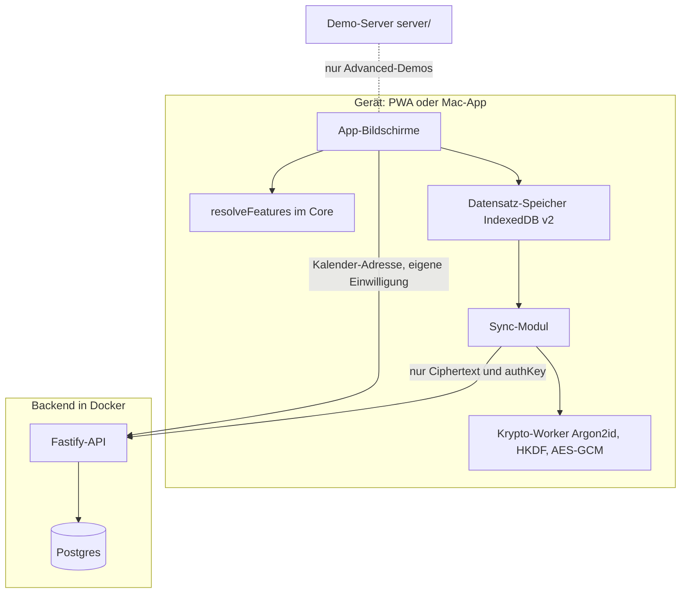
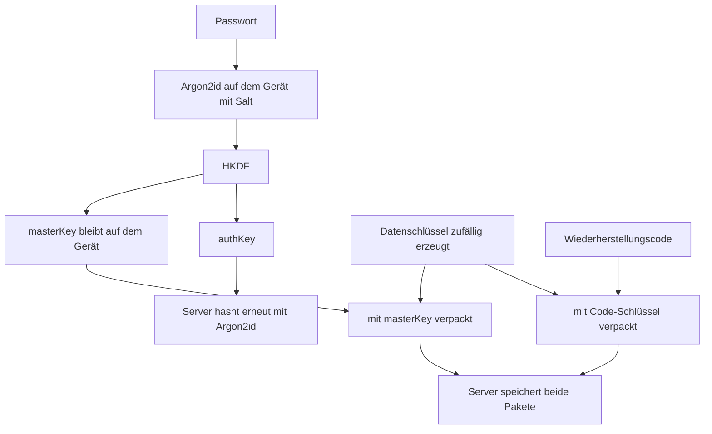
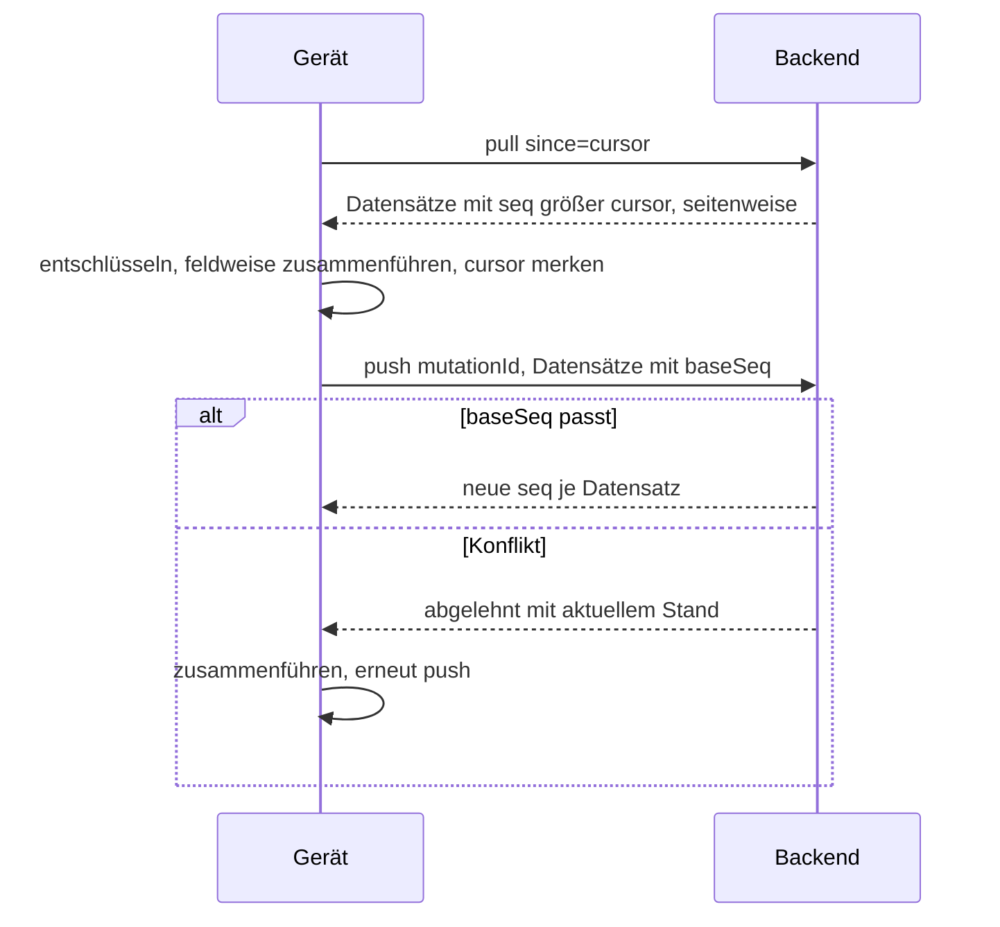
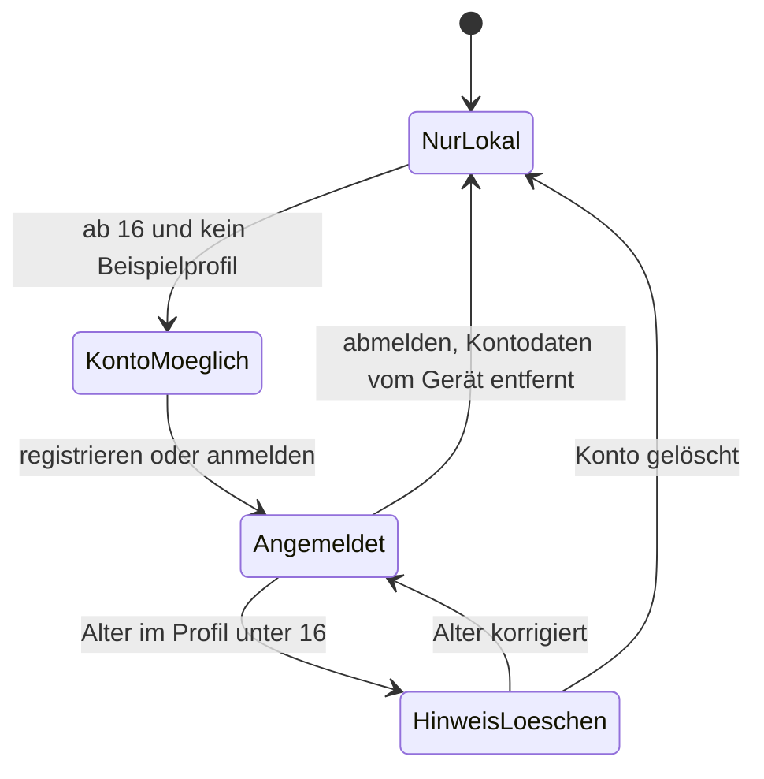

# Backend-Fundament mit Konto und verschlüsseltem Sync - Plan

## Goal Capsule

- **Objective:** Wer Headroom nutzt, sieht auf Handy, Browser und Mac denselben Stand seiner Jobs, Schichten und Grenzen. Die App bleibt offline voll nutzbar, und der Betreiber des Servers kann keine dieser Daten lesen. Jede Funktion erscheint nur für die Profile, für die sie gedacht ist.
- **Means:** zuerst eine zentrale Freigabe von Funktionen und eine versionierte lokale Datenhaltung (KTD1, KTD2), dann ein eigenes TypeScript-Backend mit Postgres (KD2), Konto ab 16 (KD3) und Ende-zu-Ende-verschlüsselter Sync je Datensatz (KD1, KTD4 bis KTD7).
- **Rangfolge bei Widersprüchen:**
  1. `CLAUDE.md`
  2. Product Contract (R-IDs)
  3. Key Technical Decisions (KTD-IDs)
  4. Implementation Units
- **Abbrechen und nachfragen, wenn:**
  - eine Einheit Klartext-Nutzerdaten an den Server schicken müsste, außer im Kalender-Abruf (R17);
  - eine Migration bestehende lokale Daten verwerfen würde;
  - die rechtliche Prüfung zum Einwilligungsalter (OQ1) ergibt, dass Konten ab 16 so nicht zulässig sind.
- **Ausführung:** sieben Pull Requests in der Reihenfolge der Gruppen unter Implementation Units.
  - Je Gruppe ein Branch nach `CLAUDE.md` (`feature/…`).
  - Bennet prüft und mergt jeden PR selbst. Nichts wird gepusht, solange er es nicht sagt.
  - Vor jedem Commit mit mehr als einer kleinen Änderung läuft `ce-code-review`.
  - Vor dem Merge von PR4 bis PR7 läuft zusätzlich `security-reviewer`.

---

## Product Contract

### Summary

Headroom bekommt in vier Phasen ein stabiles Fundament:
1. **Ohne Server:** Eine Registry im Core entscheidet für jede Funktion, ob sie aktiv ist. Die lokalen Daten werden je Datensatz mit Version gespeichert.
2. **Backend-Gerüst:** ein eigenes Backend (`backend/`), das sich per Docker installieren lässt.
3. **Konto:** Wer 16 oder älter ist, kann ein Konto anlegen. Das Passwort verlässt das Gerät nie.
4. **Sync:** Die Daten werden Ende-zu-Ende-verschlüsselt abgeglichen. Danach zieht der Kalender-Abruf aus dem Demo-Server ins Backend um.

Was die App insgesamt kann und in welcher Reihenfolge es gebaut wird, steht in `docs/Funktionskatalog.md`. Dieser Plan setzt die Stufen P0 und den Konto-Teil von P1 um.

### Problem Frame

Heute liegt der ganze Zustand als ein einziger Block in IndexedDB (`app/src/lib/storage.ts`), ohne Schema-Version. Ein einziger fehlerhafter Datensatz lässt `normalizeState` den gesamten Stand verwerfen. Wer das Gerät wechselt, verliert alles, wenn er nicht vorher den JSON-Export nutzt.

Der Server (`server/src/index.ts`) ist ausdrücklich eine Demo: kein Konto, keine Tests, kein Rate-Limit. Ob eine Funktion erscheint, entscheiden vier verstreute Stellen. Die Eltern-Seite ist dadurch über ihre Route für alle erreichbar.

Unter den Nutzer:innen sind Minderjährige. Deshalb muss jede Datenübertragung so gebaut sein, dass ein Fehler auf dem Server keine Schichten, Löhne oder Geburtsdaten preisgibt.

### Requirements

**Freigabe von Funktionen**

- R1. Für jede Funktion aus `docs/Funktionskatalog.md` entscheidet genau eine Stelle im Core, ob sie aktiv ist. Menü, Routen und Karten fragen nur dort nach.
- R2. Eine nicht freigegebene Route zeigt nie ihren Inhalt, auch wenn sie direkt angesteuert wird.
- R3. Alle Altersprüfungen rechnen mit dem Geburtsdatum an einem übergebenen Datum, wo ein Geburtsdatum vorliegt. Sonst rechnen sie mit dem angegebenen Alter.
- R4. Wochenkalender mit Schulzeit-Markierung und Job-Kombinationen sind ohne Advanced-Modus aktiv, sobald ihre fachliche Bedingung zutrifft (Katalog F50, F51).

**Lokale Daten**

- R5. Bestehende lokale Daten aus Version 1 werden beim ersten Start ohne Verlust in das neue Format übernommen.
- R6. Ein ungültiger Datensatz wird einzeln aussortiert und gemeldet. Die übrigen Daten bleiben erhalten. Aussortierte Datensätze werden unverändert in einem eigenen Bereich aufbewahrt und mit exportiert, bis die Person sie verwirft.
- R7. Wird ein Job gelöscht, werden seine Schichten und Einmalzahlungen mitgelöscht. Löscht ein Gerät einen Job, während ein anderes offline eine Schicht oder Zahlung dafür anlegt oder ändert, wird nichts still verworfen: Der betroffene Datensatz bleibt erhalten, und die App meldet einen Konflikt (Job wiederherstellen oder Datensatz mitlöschen). Dasselbe gilt, wenn ein Gerät einen Datensatz löscht und ein anderes ihn danach ändert.
- R8. Es gibt drei getrennte Löschaktionen:
  - „auf diesem Gerät löschen“,
  - „Konto löschen“,
  - „alles löschen“ (Gerät und Konto).
  Jede sagt vorher in Klartext, was danach weg ist. Der bestehende Knopf „Alle Daten löschen“ wird zu „auf diesem Gerät löschen“. Er meldet zuerst ab (mit der Warnung aus R19), entfernt die lokalen Daten ohne Löschvermerke und lässt das Konto unverändert. Andere Geräte behalten alle Daten.
- R9. „Auf diesem Gerät löschen“ entfernt auch die Kennzeichnung als Beispielprofil.

**Konto**

- R10. Ein Konto kann nur anlegen, wer laut Profil an diesem Tag mindestens 16 ist und kein Beispielprofil nutzt.
- R11. Das Passwort und der Datenschlüssel verlassen das Gerät nie im Klartext.
- R12. Bei der Registrierung bekommt die Person einen Wiederherstellungscode. Sie bestätigt ausdrücklich, dass ohne Passwort und Code die Daten auf dem Server nicht wiederherstellbar sind.
- R13. Passwort ändern, Konto löschen und „alles löschen“ verlangen das aktuelle Passwort erneut.
- R14. Sinkt das Alter im Profil später unter 16, bietet die App das Löschen des Kontos an. Sie löscht nicht selbst.

**Sync**

- R15. Mit Konto gleichen sich Profil, Jobs, Schichten, Zahlungen, Kalenderquellen und Einstellungen (Sprache, Dunkelmodus) zwischen Geräten ab. Advanced-Flags, `isPremium`, `peerToken`, `pendingImports` und Beispielprofile bleiben auf dem Gerät.
- R16. Änderungen, die offline auf zwei Geräten entstehen, gehen beim Abgleich nicht verloren. Bei Konflikten im selben Feld gewinnt die spätere Änderung.
- R17. Der Server speichert nur verschlüsselte Datensätze. Die einzige Ausnahme ist der Kalender-Abruf: Er reicht die Kalender-Adresse im Klartext durch, speichert sie aber nicht. Er braucht eine eigene Einwilligung.
- R18. Wer sich auf einem Gerät mit eigenen lokalen Daten anmeldet, entscheidet, ob diese mit dem Konto zusammengeführt oder durch den Kontostand ersetzt werden.
- R19. Beim Abmelden werden die Kontodaten von diesem Gerät entfernt. Gibt es noch nicht übertragene Änderungen, warnt die App vorher.
- R20. Ein älterer App-Stand, der neuere Datensätze empfängt, verändert sie nicht und verliert keine Felder, die er nicht kennt.

**Betrieb**

- R21. Das Backend lässt sich mit einer Datei für Docker Compose samt Datenbank starten und meldet Zustand und Bereitschaft.
- R22. Jeder Endpunkt prüft seine Eingaben, hat ein Rate-Limit und schreibt keine E-Mail-Adressen, Token oder Inhalte ins Log (`CLAUDE.md`, Backend und Sicherheit).

### Key Decisions

- KD1. **Konto mit Ende-zu-Ende-verschlüsseltem Sync, die App bleibt lokal zuerst.** Governs R11, R15, R16, R17. (session-settled: user-directed — chosen over a server that stores readable data and over shared services without accounts: strong privacy for minors while keeping multi-device use)
- KD2. **Eigenes Backend in TypeScript mit Postgres.** Governs R21, R22. (session-settled: user-directed — chosen over Supabase: shares `packages/core` and avoids a vendor dependency)
- KD3. **Konto erst ab 16, darunter nur lokal.** Governs R10, R14. Stützt sich auf das schon geprüfte `consentAgeRule` in `packages/core/data/privacy.ts`. (session-settled: user-approved — chosen over accounts for all ages with a parental-consent flow: avoids verifying parental consent before there is a need)
- KD4. **Kein Zurücksetzen des Passworts über E-Mail.** Governs R12. Bei Ende-zu-Ende-Verschlüsselung kann der Server ohne Passwort oder Wiederherstellungscode nichts entschlüsseln. Ein Mail-Reset würde nur ein leeres Konto zurückgeben.

### Scope Boundaries

**Nicht Teil dieses Plans:**
- Alle P2- und P3-Funktionen des Katalogs außer dem Umzug des Kalender-Abrufs (F41) und der Freigabe von F50/F51.
- Gestaltung neuer Bildschirme über das Nötige hinaus. Die Konto-Bildschirme folgen `design-system/headroom/MASTER.md`, das Redesign kommt später.
- Lohnstatistik, Jobbörse und Partner. Sie bleiben im Demo-Server `server/`.

**Erwogen und nicht gebaut:**
- **E-Mail-Bestätigung bei der Registrierung.** Sie bräuchte einen Mail-Anbieter mit Auftragsverarbeitungsvertrag. Bei Ende-zu-Ende-Verschlüsselung bringt sie keine Wiederherstellung. Neu bewerten, sobald Erinnerungen per Mail (F67) kommen.
- **OPAQUE statt abgeleitetem Anmeldeschlüssel.** Das Verfahren ist reif genug, aber aufwendig für ein kleines Team. Ein Feld `authScheme` hält den Wechsel offen (KTD3).
- **Ein CRDT-Framework (Evolu, Automerge).** Eine Zeitmarke je Feld reicht für Formulardaten ohne gemeinsames Tippen. Neu bewerten, falls mehrere Personen gleichzeitig dieselben Daten bearbeiten sollen.

### Deferred to Follow-Up Work

- Anmelden mit Passkeys.
- Eltern-Link (F66) auf Basis der Konten.
- Umzug von Lohnstatistik und Jobbörse in das Backend, danach Abschalten von `server/`.
- Automatisches Löschen inaktiver Konten, sobald OQ2 entschieden ist.

### Open Questions

- OQ1 (blockiert PR5, nicht PR1 bis PR4). Welche Rechtsgrundlage gilt für das Konto: Vertrag oder Einwilligung? Nur bei Einwilligung greift Art. 8 DSGVO direkt. Kurz rechtlich prüfen lassen und das Ergebnis mit Quelle in `packages/core/data/privacy.ts` vermerken. Bis dahin gilt die strengere Annahme (ab 16).
- OQ2 (blockiert den Start im Betrieb, nicht den Bau). Werden inaktive Konten gelöscht, und nach welcher Frist? Vorschlag: 24 Monate, mit Hinweis in der App vorher.
- OQ3 (blockiert den Start im Betrieb). Bei welchem Anbieter in der EU läuft das Backend?

---

## Planning Contract

### Key Technical Decisions

- KTD1. **Feature-Registry als reine Funktion im Core.** `resolveFeatures` bekommt Profil, Jobs, Einstellungen, Kontostatus und Datum und liefert die aktiven Funktions-IDs. Die bestehenden Regeln werden übernommen statt neu geschrieben: `isStudentMode`, `youthLaborApplies`, `studentModeHidden`, `effectiveFeatures`, `consentAgeRule`, `detectedCombinations`. `FeatureName`, `defaultFeatures`, `effectiveFeatures` und die Liste aus `studentModeHidden.features` ziehen dafür aus `app/src/config/` in den Core, die App-Dateien exportieren sie nur noch weiter. Der Speicher der Flags bleibt in der App (`app/src/lib/flags.ts`). Governs R1 to R4.
- KTD2. **Lokale Datenhaltung je Datensatz in IndexedDB, Datenbank `headroom-local` Version 2.**
  - Jeder Datensatz hat die Form `{id, kind, schemaVersion, fields, fieldClock, deleted}`.
  - Die Migration von Version 1 liest den alten Block, prüft jeden Datensatz einzeln und schreibt ihn neu.
  - Den alten Block behält sie bis zum nächsten erfolgreichen Start, damit bei einem Fehler nichts verloren ist. Erst dieser Start entfernt ihn, nachdem er geprüft hat, dass jeder Datensatz aus dem Block im neuen Speicher steht.
  - Die Logik für Schema-Migrationen, Zusammenführung und das Löschen abhängiger Datensätze liegt im Core. Sie muss auf dem Gerät laufen, weil der Server die Daten nicht lesen kann.
- KTD3. **Anmeldung über einen abgeleiteten Schlüssel, nie über das Passwort.** Governs R11, R13.
  - Auf dem Gerät erzeugt Argon2id aus Passwort und Salt einen Wert. Aus ihm leitet HKDF zwei Schlüssel ab: `masterKey` (bleibt auf dem Gerät und verpackt den Datenschlüssel) und `authKey` (geht an den Server).
  - Der Server hasht `authKey` noch einmal mit Argon2id (`crypto.argon2` ab Node 24.7, sonst `@node-rs/argon2`).
  - Der Server liefert das Salt über `prelogin`. Für unbekannte E-Mail-Adressen gibt er ein festes Schein-Salt zurück, damit sich nicht prüfen lässt, ob eine Adresse registriert ist.
  - Die App kennt Mindestwerte für die Argon2id-Einstellungen und lehnt schwächere ab: 19 MiB Speicher, 2 Durchläufe, Parallelität 1 (OWASP Password Storage Cheat Sheet). So kann ein manipulierter Server die Einstellungen nicht absenken.
  - Registrieren mit einer schon vorhandenen Adresse liefert eine neutrale Ablehnung. Dass sich darüber prüfen lässt, ob eine Adresse registriert ist, wird ohne E-Mail-Bestätigung hingenommen, durch das Rate-Limit gebremst und im README genannt.
  - Ein Feld `authScheme` am Konto hält einen späteren Wechsel offen.
  - Dasselbe Muster nutzen Bitwarden und Standard Notes (Protokoll 004).
- KTD4. **Argon2id auf dem Gerät mit hash-wasm in einem Web Worker.** Startwerte: 64 MiB Speicher, 3 Durchläufe, Parallelität 1. Die endgültigen Werte legt ein Messlauf auf einem schwachen Handy fest. `argon2-browser` wird seit 2022 nicht mehr gepflegt.
- KTD5. **Verschlüsselung je Datensatz mit AES-GCM über WebCrypto.** Governs R17.
  - Jede Verschlüsselung bekommt einen zufälligen 96-Bit-IV.
  - Als zusätzliche Daten (AAD) gehen `encVersion|userId|recordId` mit ein. So kann der Server keine Datensätze vertauschen.
  - Die Art des Datensatzes (`kind`) steht nur im verschlüsselten Inhalt. Der Server sieht je Datensatz nur zufällige ID, `seq`, Löschkennzeichen und Ciphertext, damit er etwa Schichten nicht zählen kann.
  - Der Datenschlüssel wird zweimal verpackt: einmal mit `masterKey`, einmal mit einem Schlüssel aus dem Wiederherstellungscode.
  - Der Wiederherstellungscode entsteht auf dem Gerät aus mindestens 128 Bit Zufall und wird in Gruppen angezeigt. Aus ihm leitet HKDF mit eigenen Bezeichnern zwei Schlüssel ab: einen zum Verpacken des Datenschlüssels und `recoveryAuthKey`, dessen Argon2id-Hash der Server speichert. Nur gegen `recoveryAuthKey` gibt der Server das zweite Paket heraus.
  - Auf dem Gerät liegt der entpackte Datenschlüssel nur als nicht exportierbarer `CryptoKey` in IndexedDB, das Token ebenfalls in IndexedDB, nie in localStorage. Passwort und `masterKey` werden nicht gespeichert.
  - Beim Passwortwechsel wird nur neu verpackt, die Datensätze werden nicht neu verschlüsselt.
- KTD6. **Abgleich mit fortlaufender Nummer je Nutzer:in und Kennung je Übertragung.** Governs R16.
  - Die Nummer `seq` vergibt der Server aus einer Zählerzeile je Nutzer:in, innerhalb der Transaktion, die einen Push speichert. Bei einer globalen Postgres-Sequenz könnten Pulls mit `seq > cursor` Zeilen überspringen, weil Transaktionen in anderer Reihenfolge abschließen als sie beginnen.
  - Jeder Push trägt eine `mutationId`. Wiederholungen werden erkannt und nicht doppelt gespeichert.
  - Ein Push wird abgelehnt, wenn `baseSeq` nicht zum gespeicherten Stand passt.
  - Pull ist seitenweise und liefert auch Löschvermerke.
  - Löschvermerke bleiben 180 Tage und werden dann von einem täglichen Lauf entfernt. Der Server merkt sich je Konto, bis zu welcher `seq` bereinigt wurde. Ein Pull mit älterem Cursor bekommt die Antwort „vollständig neu abgleichen“, und das Gerät holt alles ab 0 und führt zusammen. So kann ein lange offline gewesenes Gerät gelöschte Daten nicht zurückbringen.
  - Ein abgelehnter Push wird nicht unter seiner `mutationId` gespeichert. Der neue Versuch nach dem Zusammenführen bekommt eine neue `mutationId`.
- KTD7. **Feldweise Zusammenführung mit einer hybriden logischen Uhr (HLC).** Governs R16, R20.
  - Jedes Feld trägt im verschlüsselten Datensatz seine eigene Zeitmarke. Gleicht ein Gerät ab, gewinnt je Feld die jüngere Marke.
  - `handledTransitions` und `parentalConsent` werden als Menge bzw. je Schlüssel zusammengeführt.
  - Felder, die das Gerät nicht kennt, bleiben unverändert erhalten.
  - Datensätze mit höherer `schemaVersion`, als das Gerät kennt, sind dort nur lesbar.
- KTD8. **Anmeldetoken als Bearer im Header, nicht als Cookie.**
  - Die App unter `app://headroom` ruft einen Server unter `https://` auf. Das ist ein Aufruf über die Seitengrenze hinweg, Cookies sind dort unzuverlässig. Ein Token im Header schließt außerdem CSRF aus.
  - Das Token ist zufällig erzeugt. Der Server speichert nur seinen SHA-256-Hash.
  - Es läuft nach 30 Tagen ohne Nutzung ab.
- KTD9. **Backend-Technik.**
  - Fastify 5 mit `fastify-type-provider-zod` (ab v7, braucht Zod 4.2 oder neuer).
  - Kysely mit dem eingebauten Migrator, Postgres 17.
  - pino mit Schwärzung von `authorization`, `email`, `authKey` und `ciphertext`.
  - `@fastify/helmet`, `@fastify/rate-limit`, `@fastify/cors` mit fester Liste erlaubter Ursprünge.
  - Die API-Schemas liegen in `packages/contracts` und werden von App und Backend geteilt.
- KTD10. **Neues Backend neben dem Demo-Server.** `backend/` ist ein neuer Workspace. `server/` bleibt für die P3-Demos unverändert, bis auf den Hinweis auf den Umzug in U11. Die Mac-App ruft das Backend direkt über seine Adresse auf. `desktop/main.cjs` beantwortet `/api/*` und `/health` weiter mit 503 und leitet nichts weiter.

### High-Level Technical Design

Komponenten und Datenfluss:



Schlüssel bei der Registrierung:



Ein Abgleich:



Kontostatus auf einem Gerät:



### Assumptions

- Das Alter, das jemand angibt, wird nicht überprüft. Der Server kennt es nicht, weil das Profil verschlüsselt ist. Die Grenze von 16 setzt die App durch. Bei der Registrierung bestätigt die Person ihr Alter ausdrücklich.
- Eine Person nutzt ihr Konto allein. Dass mehrere Personen auf dieselben Daten zugreifen, ist nicht vorgesehen.
- Die Datenmengen sind klein: wenige hundert Schichten pro Jahr. Ein voller Abgleich nach einer Neuanmeldung muss nicht in Stücken erfolgen, abgesehen von der Seitenaufteilung des Pulls.

### Output Structure

```text
packages/
  core/src/features/        Registry und resolveFeatures
  core/src/records/         Datensatz-Schema, Migrationen, Zusammenführung, Uhr je Feld, Löschen abhängiger Datensätze
  contracts/                Zod-Schemas der API
backend/
  src/                      Fastify-App, Routen, Konfiguration
  src/db/migrations/        Kysely-Migrationen
  test/                     Integrationstests gegen Postgres
  Dockerfile
docker-compose.yml
app/src/lib/db/             Datensatz-Speicher und Migration von v1
app/src/lib/crypto/         Krypto-Worker
app/src/lib/sync/           Sync-Modul
app/src/features/account/   Konto-Bildschirme
.github/workflows/ci.yml
```

---

## Implementation Units

### PR1: Zentrale Freigabe von Funktionen

Waits on: nothing.

### U1. Feature-Registry und Altersprüfung im Core

- **Goal:** Eine Stelle entscheidet über jede Funktion aus dem Katalog.
- **Requirements:** R1, R3, R4, R10 (nur die Bedingung, noch kein Konto). Setzt KTD1 um.
- **Dependencies:** keine.
- **Files:**
  - neu: `packages/core/src/features/registry.ts`, `packages/core/src/features/registry.test.ts`
  - geändert: `packages/core/src/index.ts`, `packages/core/src/combinations.ts`, `packages/core/data/privacy.ts`, `app/src/config/features.ts`, `app/src/config/studentMode.ts` (nur noch Weiterexport)
- **Approach:**
  1. Jede Funktions-ID aus `docs/Funktionskatalog.md` (F01 bis F71) als Eintrag mit Priorität und Bedingung anlegen. Funktionen, die es noch nicht gibt, sind nie aktiv.
  2. `consentAgeReached(profile, date)` neben `consentAgeRule` ergänzen. Es nutzt `ageOn`, wenn `birthDate` gesetzt ist, sonst `profile.age`.
  3. F50 und F51 ohne Advanced-Bedingung eintragen (R4).
  4. Die Bedingung „Konto möglich“ ist: ab 16 und `example` nicht gesetzt. „Konto vorhanden“ ist eine eigene Bedingung, unabhängig vom Alter (für R14).
  5. Die Standardwerte `new Date().getFullYear()` in `limitRecord`, `limitValue`, `latestKnownLimitValue`, `usableLimitValue`, `activeLimits` und `possibleCombinations` entfernen; das Jahr wird übergeben.
- **Patterns to follow:** `packages/core/src/rules/youthLabor/profile.ts` (reine Funktionen mit Datum), `app/src/config/studentMode.ts` (eine Stelle für den Schüler-Modus).
- **Test scenarios** (alle mit festem Datum 2026-10-31):
  - Geburtsdatum 2010-11-01 ergibt 15 Jahre: Konto nicht möglich. 2010-10-31 ergibt genau 16: möglich. 2010-10-30: möglich.
  - Geburtsdatum 2008-11-01 ergibt 17: Schüler-Modus an. 2008-10-31 ergibt 18 ohne bestätigten Übergang, Status Schüler:in: Schüler-Modus an. Mit bestätigtem Übergang: aus.
  - Nur `age` 16, kein Geburtsdatum: Konto möglich. `age` 15: nicht möglich.
  - Beispielprofil Mia (16) aktiv: Konto nicht möglich.
  - Schüler-Modus und Advanced mit `jobBoard`: Jobbörse nicht aktiv.
  - Ohne Advanced, mit Minijob und kurzfristigem Job: Job-Kombinationen aktiv.
  - Ohne Advanced, im Schüler-Modus: Wochenkalender aktiv, mit Schulzeit-Markierung. Ohne Advanced, Student:in 20: Wochenkalender aktiv, ohne Schulzeit-Markierung (Katalog F50: immer).
  - Status Werkstudent:in: 26-Wochen-Regel aktiv. Status Minijobber:in: nicht aktiv.
  - Jede ID aus dem Katalog steht in der Registry. Das prüft ein Test gegen eine Liste.
- **Verification:** Alle bisherigen Freigaben ergeben für die drei Beispielprofile dasselbe wie vorher, mit Ausnahme von F50 und F51.

### U2. App nutzt die Registry für Menü und Routen

- **Goal:** Keine Route zeigt Inhalt, der nicht freigegeben ist.
- **Requirements:** R1, R2.
- **Dependencies:** U1.
- **Files:**
  - geändert: `app/src/App.tsx`, `app/src/features/more/MorePage.tsx`, `app/src/features/dashboard/RoleLimits.tsx`, `app/src/features/shifts/ShiftsPage.tsx`, `app/src/features/advanced/JobBoardPage.tsx`, `app/src/features/advanced/TaxAppCard.tsx`, `app/src/features/advanced/PeerStatsPage.tsx`
  - neu: `app/src/config/featureGate.test.tsx`
  - geändert: `app/e2e/smoke.spec.ts`
- **Approach:**
  1. `resolveFeatures` einmal je Darstellung in `App.tsx` berechnen und weitergeben.
  2. Die Weiche für die Bildschirme fällt bei nicht freigegebenen Bildschirmen auf `More` zurück, auch bei `Parents`.
  3. Die vier direkten Vergleiche von `profile.age` mit `consentAgeRule.minimumAge` durch die Registry ersetzen.
  4. `studentModeFeatures` und `effectiveFeatures` bleiben als Eingaben der Registry, Komponenten fragen sie nicht mehr selbst.
- **Patterns to follow:** bestehende Sperren in `App.tsx` für `Developer`, `JobBoard` und `Premium`.
- **Test scenarios:**
  - Standardprofil (Student, 20), `Parents` direkt angesteuert: Es erscheint die More-Seite.
  - Mia (16): Der Menüeintrag Eltern ist sichtbar, und `Parents` öffnet sich.
  - Profil 15: Partnerhinweise erscheinen auch mit Advanced nicht.
  - E2E: Schüler-Profil ohne Advanced sieht den Wochenkalender und eine rot markierte Schicht in der Schulzeit.
- **Verification:** `npm test` und `npm run test:e2e` laufen durch. Im Browser hell und dunkel sowie in Handybreite angesehen.

### PR2: Lokale Datenhaltung je Datensatz

Waits on: PR1, nur Merge-Reihenfolge.

### U3. Datensatz-Schema, Migrationen und Zusammenführung im Core

- **Goal:** Eine geräteunabhängige Beschreibung jedes Datensatzes, die Migrationen und das Zusammenführen kann.
- **Requirements:** R6, R7, R15, R16, R20. Setzt KTD2 und KTD7 um.
- **Dependencies:** keine.
- **Files:**
  - neu: `packages/core/src/records/schema.ts`, `packages/core/src/records/migrate.ts`, `packages/core/src/records/merge.ts`, `packages/core/src/records/hlc.ts`, `packages/core/src/records/cascade.ts`
  - Tests: `packages/core/src/records/*.test.ts`
- **Approach:**
  1. Arten von Datensätzen: `profile`, `job`, `shift`, `payment`, `calendarSource`, `settings` (nur Sprache und Dunkelmodus) und `deviceState`. Jede Art legt fest, ob sie synchronisiert wird (R15). `deviceState` wird nie synchronisiert und hält `example`, `isPremium`, `peerToken`, `pendingImports`, `onboarded`, `dismissedRecommendations` und `peerOptIn`.
  2. Das Zusammenführen arbeitet je Feld nach Zeitmarke (KTD7). Unbekannte Felder werden übernommen.
  3. Das Löschen eines Jobs liefert die Löschvermerke für alle seine Schichten und Zahlungen mit. Trifft beim Zusammenführen ein Löschvermerk auf eine spätere Änderung, oder verweist eine lebende Schicht oder Zahlung auf einen gelöschten Job, meldet der Core einen Konflikt und verwirft nichts (R7).
  4. `normalizeState` aus `app/src/lib/storage.ts` liefert die Regeln, mit denen jeder Datensatz einzeln geprüft wird. Ein ungültiger Datensatz kommt unverändert in einen eigenen Bereich (`quarantine`), statt verworfen zu werden (R6).
  5. Feste IDs für Einzel-Datensätze (`profile`, `settings`, `device`). Dass der Server daran die Art erkennen könnte, löst PR6 beim Verschlüsseln (KTD5).
- **Execution note:** zuerst Tests für die Zusammenführung und die Uhr, dann die Umsetzung.
- **Test scenarios:**
  - Zwei Geräte ändern offline verschiedene Felder derselben Schicht: Beide Änderungen bleiben.
  - Zwei Geräte ändern dasselbe Feld: Die jüngere Zeitmarke gewinnt. Bei gleicher Zeit entscheidet die Geräte-ID, immer gleich.
  - Die Uhr eines Geräts geht 10 Minuten nach: Die Uhr springt nach dem Empfang trotzdem vorwärts.
  - `handledTransitions` auf A `['adult:2026']`, auf B `['school:2026:dismissed']`: Nach dem Abgleich enthält es beide.
  - Datensatz mit `schemaVersion` 3 auf einem Gerät, das 2 kennt: wird angezeigt, aber nicht geschrieben.
  - Ein Gerät, das `schemaVersion` 3 kennt, führt einen Datensatz mit unbekanntem Feld `neuesFeld` zusammen: Das Feld bleibt unverändert.
  - Job mit 3 Schichten und 1 Zahlung löschen: 5 Löschvermerke.
  - Schicht verweist auf einen fehlenden Job: einzeln aussortiert und aufbewahrt, die übrigen 20 Schichten bleiben.
  - Gerät A löscht einen Job, Gerät B legt danach offline eine Schicht dafür an: Die Schicht bleibt, ein Konflikt wird gemeldet.
  - Gerät A löscht eine Schicht, Gerät B ändert sie danach: Die Schicht bleibt, ein Konflikt wird gemeldet. Ändert B sie vorher, gewinnt das Löschen.
- **Verification:** Die Tests im Core laufen. Es gibt keinen Aufruf von `new Date()` in `records/`.

### U4. Datensatz-Speicher in der App und Migration von Version 1

- **Goal:** Die App speichert je Datensatz und übernimmt alte Daten verlustfrei.
- **Requirements:** R5, R6, R8, R9.
- **Dependencies:** U3.
- **Files:**
  - neu: `app/src/lib/db/recordStore.ts`, `app/src/lib/db/migrateV1.ts`, `app/src/lib/db/recordStore.test.ts`
  - geändert: `app/src/lib/storage.ts`, `app/src/App.tsx`, `app/src/features/more/SettingsPage.tsx`
- **Approach:**
  1. IndexedDB `headroom-local` auf Version 2 heben, mit einem Store `records`.
  2. `App.tsx` behält `AppState` als Ansicht im Speicher. Gespeichert werden nur die geänderten Datensätze, nicht mehr der ganze Block.
  3. Export und Import bleiben im bisherigen Format (`stateForExport`). Ein Import wird pro Datensatz übernommen.
  4. „Alle Daten löschen“ heißt jetzt „auf diesem Gerät löschen“, leert den Speicher ohne Löschvermerke und setzt `example` zurück (R8, R9). „Konto löschen“ und „alles löschen“ erscheinen erst mit U8.
  5. Aussortierte Datensätze erscheinen in den Einstellungen mit Anzahl, werden mit exportiert und lassen sich verwerfen (R6).
- **Patterns to follow:** `app/src/lib/storage.ts` (Rückfall auf localStorage, `normalizeState`).
- **Test scenarios:**
  - Ein Block aus Version 1 mit 2 Jobs, 30 Schichten und 1 Zahlung: Danach stehen 33 Datensätze (2 Jobs, 30 Schichten, 1 Zahlung) plus Profil, Einstellungen und Gerätezustand im Speicher. Der alte Block bleibt bis zum nächsten erfolgreichen Start.
  - Jedes Feld der obersten Ebene von `AppState` aus dem Block steht danach in genau einem Datensatz.
  - Ein Block aus Version 1 mit einer kaputten Schicht: 29 Schichten übernommen, ein Hinweis erscheint.
  - Die Migration bricht mittendrin ab: Beim nächsten Start läuft sie erneut, ohne doppelte Datensätze.
  - „Auf diesem Gerät löschen“ bei aktivem Beispiel Lena: `example` ist danach leer, das Onboarding erscheint, und der Speicher enthält keine Löschvermerke.
  - Export bei einer aussortierten Schicht: Die Datei enthält sie unter `quarantine`.
  - Daten nur in localStorage (Fallback): werden übernommen.
- **Verification:** `npm test` und `npm run test:e2e` laufen durch. Ein echtes Profil aus dem Browser bleibt nach dem Update vollständig.

### PR3: Gemeinsame Schemas und CI

Waits on: nothing.

### U5. Paket `packages/contracts` und GitHub Actions

- **Goal:** Ein gemeinsamer Vertrag für die API und eine Prüfung bei jedem Push.
- **Requirements:** R22.
- **Dependencies:** keine.
- **Files:**
  - neu: `packages/contracts/package.json`, `packages/contracts/src/auth.ts`, `packages/contracts/src/sync.ts`, `packages/contracts/src/contracts.test.ts`, `.github/workflows/ci.yml`
  - geändert: `package.json` (Workspaces und Skript `test`)
- **Approach:**
  1. Zod-Schemas für `prelogin`, `register`, `login`, `recover`, `logout`, `account`, `keys`, `sync/push` und `sync/pull` anlegen. Grenzen gehören dazu: höchstens 500 Datensätze je Push, höchstens 64 KB je Datensatz.
  2. Die CI führt `npm ci`, `npm test`, `npm run build` und die Typprüfung aller Workspaces aus.
- **Test scenarios:**
  - Ein Push mit 501 Datensätzen wird abgelehnt.
  - Ein Datensatz mit 65 KB Ciphertext wird abgelehnt.
  - Ein unbekannter Schlüssel im Body wird abgelehnt.
  - Eine Anmeldung ohne `authKey` wird abgelehnt.
- **Verification:** Die CI läuft auf dem Branch durch.

### PR4: Backend-Gerüst

Waits on: PR3, muss gemergt sein, bevor die Arbeit beginnt (nutzt `packages/contracts`).

### U6. Workspace `backend/` mit Datenbank, Docker und Testumgebung

- **Goal:** Ein installierbares Backend ohne fachliche Endpunkte, aber mit allen Schutzschichten.
- **Requirements:** R21, R22. Setzt KTD9 und KTD10 um.
- **Dependencies:** U5.
- **Files:**
  - neu: `backend/package.json`, `backend/tsconfig.json`, `backend/src/app.ts`, `backend/src/config.ts`, `backend/src/db/index.ts`, `backend/src/db/migrations/001_init.ts`, `backend/Dockerfile`, `docker-compose.yml`, `backend/test/health.test.ts`, `backend/test/helpers/db.ts`
- **Approach:**
  1. Die Konfiguration wird beim Start mit Zod geprüft: Datenbank-Adresse, erlaubte Ursprünge, Port. Fehlt etwas, startet das Backend nicht.
  2. `/health` meldet, dass der Prozess läuft. `/ready` prüft zusätzlich die Datenbank.
  3. Das Rate-Limit gilt global, enger für `/v1/auth/*`.
  4. Logs: IP-Adressen werden geschwärzt, Docker Compose behält Log-Dateien höchstens 14 Tage. Beim Anbieter aus OQ3 wird das erneut eingestellt.
  5. Die erlaubten Ursprünge für CORS kommen aus der Konfiguration, darunter `app://headroom`. Pflicht ist auch `PRELOGIN_SECRET` (mindestens 32 Byte, nur aus Umgebung oder Docker-Secret).
  6. Die Integrationstests nutzen ein echtes Postgres aus Docker Compose. Jeder Test bekommt ein eigenes Schema.
- **Execution note:** vor allem Prüfung im laufenden Betrieb; Unit-Tests nur für die Konfiguration.
- **Test scenarios:**
  - `/ready` ohne erreichbare Datenbank: 503.
  - Anfrage von einem nicht erlaubten Ursprung: keine CORS-Header.
  - Mehr Anfragen an `/health` als das globale Limit in einer Minute von derselben Adresse: Die erste darüber bekommt 429.
  - Eine Anfrage mit `Authorization`-Header: Im Log steht der Header geschwärzt.
  - Fehlende `DATABASE_URL`: Der Start bricht mit klarer Meldung ab.
- **Verification:** `docker compose up` startet API und Datenbank, `/ready` antwortet mit 200. Die Typprüfung von `backend/` läuft durch.

### PR5: Konto

Waits on: PR4 und PR2, beide müssen gemergt sein, bevor die Arbeit beginnt (U8 nutzt `backend/` und den Datensatz-Speicher). Merge erst, wenn OQ1 beantwortet ist.

### U7. Konto-Endpunkte im Backend

- **Goal:** Registrieren, anmelden, abmelden, Passwort ändern und Konto löschen, ohne dass der Server das Passwort sieht.
- **Requirements:** R11, R13, R22. Setzt KTD3 und KTD8 um.
- **Dependencies:** U6.
- **Files:**
  - neu: `backend/src/routes/auth.ts`, `backend/src/routes/account.ts`, `backend/src/auth/sessions.ts`, `backend/src/db/migrations/002_accounts.ts`
  - Tests: `backend/test/auth.test.ts`, `backend/test/account.test.ts`
- **Approach:**
  1. Tabellen `accounts` (E-Mail klein geschrieben, Hash von `authKey`, Hash von `recoveryAuthKey`, Salt, KDF-Einstellungen, `authScheme`, beide Schlüsselpakete) und `sessions` (Hash des Tokens, letzte Nutzung).
  2. `prelogin` gibt für unbekannte Adressen ein festes Schein-Salt zurück, abgeleitet aus Adresse und einem Server-Geheimnis.
  3. Antworten auf eine fehlgeschlagene Anmeldung sind gleich, egal ob die Adresse existiert.
  4. Konto löschen entfernt Konto, Sitzungen und Datensätze in einer Transaktion.
  5. `recover` prüft `recoveryAuthKey`, gibt das zweite Schlüsselpaket heraus und übernimmt in einer Transaktion neuen `authKey`-Hash, Salt und neues `masterKey`-Paket. Alle Sitzungen werden ungültig. Rate-Limit wie `/v1/auth/*`.
- **Test scenarios:**
  - Registrieren, dann mit demselben `authKey` anmelden: Es kommt ein Token zurück.
  - Anmelden mit falschem `authKey`: 401 mit derselben Meldung wie bei unbekannter Adresse.
  - `prelogin` zweimal für dieselbe unbekannte Adresse: Es kommt dasselbe Salt zurück.
  - Registrieren mit einer schon vorhandenen Adresse: neutrale Ablehnung ohne Hinweis auf das bestehende Konto (KTD3).
  - Mehr Anfragen an `/v1/auth/prelogin` als das enge Limit in einer Minute von derselben Adresse: Die erste darüber bekommt 429.
  - Wiederherstellen mit richtigem Code: Das neue Passwort meldet an, alte Sitzungen bekommen 401. Mit falschem Code: 401 mit derselben Meldung wie bei unbekannter Adresse.
  - Konto löschen ohne erneuten `authKey`: 401. Mit: Konto, Sitzungen und Datensätze sind weg.
  - Ein abgelaufenes Token, 31 Tage ungenutzt: 401.
  - Passwort ändern: Alte Sitzungen sind danach ungültig, das neue Schlüsselpaket ist gespeichert.
- **Verification:** Die Integrationstests laufen gegen Postgres. `security-reviewer` und `secure-code-guardian` sind ohne offene kritische Punkte.

### U8. Schlüssel und Konto-Bildschirme in der App

- **Goal:** Wer 16 oder älter ist, kann auf dem Gerät ein Konto anlegen, sich anmelden und es löschen.
- **Requirements:** R10, R11, R12, R13, R14, R19. Setzt KTD3, KTD4 und KTD5 um.
- **Dependencies:** U1, U4, U7.
- **Files:**
  - neu: `app/src/lib/crypto/worker.ts`, `app/src/lib/crypto/keys.ts`, `app/src/lib/crypto/keys.test.ts`, `app/src/lib/api/client.ts`, `app/src/features/account/AccountPage.tsx`, `app/src/features/account/AccountPage.test.tsx`
  - geändert: `app/src/i18n/translations.ts`, `app/src/features/more/SettingsPage.tsx`, `app/src/app/types.ts`
  - Doku: `README.md` (Abschnitt „Datenschutz und Datenfluss“)
- **Approach:**
  1. Der Worker kapselt Argon2id, HKDF und das Verpacken der Schlüssel. Die Bildschirme sehen nie einen Schlüssel.
  2. Der Wiederherstellungscode wird einmal angezeigt. Er kann kopiert oder als PDF gespeichert werden; `app/src/lib/pdf.ts` wird wiederverwendet.
  3. Weiter geht es erst nach einer ausdrücklichen Bestätigung (R12).
  4. Alle Texte auf Deutsch und Englisch, mit „gilt in der Regel“ statt Rechtsauskunft.
  5. Registrieren und Anmelden erscheinen nur bei „Konto möglich“. Der Konto-Bereich selbst erscheint auch bei „Konto vorhanden“, unabhängig vom Alter, damit das Löschangebot aus R14 erreichbar bleibt.
  6. Datenschlüssel und Token liegen nach KTD5 auf dem Gerät. Abmelden und Konto löschen entfernen Schlüssel, Token und Schlüsselpakete.
  7. Unter 16 nach einer Änderung des Profils: ein Hinweis mit Angebot zum Löschen des Kontos (R14).
- **Test scenarios:**
  - Schlüssel ableiten mit einem festen Test-Salt und Passwort: liefert reproduzierbar dasselbe `authKey`. `masterKey` ist nie Teil einer Anfrage, geprüft am Netzwerk-Mock.
  - Datenschlüssel mit `masterKey` verpacken und entpacken: dasselbe Ergebnis. Mit dem Wiederherstellungscode entpacken: dasselbe Ergebnis.
  - Der Server liefert KDF-Werte unter den Mindestwerten aus KTD3 (18 MiB): Die App bricht mit Hinweis ab. Genau 19 MiB: wird angenommen.
  - Der Wiederherstellungscode hat mindestens 128 Bit und taucht in keiner Anfrage auf (Netzwerk-Mock).
  - Profil 15 ohne Konto: Der Konto-Bereich ist nicht sichtbar. Mia als Beispielprofil: nicht sichtbar.
  - Nach dem Abmelden liegt weder Schlüssel noch Token in IndexedDB oder localStorage.
  - Geburtsdatum auf 15 geändert, während ein Konto besteht: Es erscheint der Hinweis, das Konto bleibt bestehen.
- **Verification:** Im Browser hell und dunkel sowie in Handybreite durchgespielt, auf Deutsch und Englisch. Mit den Argon2id-Startwerten dauert die Ableitung auf einem Mittelklasse-Handy unter 2 Sekunden; das Ergebnis des Messlaufs ist im PR notiert.

### PR6: Verschlüsselter Sync

Waits on: PR5, muss gemergt sein, bevor die Arbeit beginnt.

### U9. Sync-Endpunkte im Backend

- **Goal:** Verschlüsselte Datensätze verlustfrei und ohne Doppelungen speichern und ausliefern.
- **Requirements:** R16, R17. Setzt KTD6 um.
- **Dependencies:** U7.
- **Files:**
  - neu: `backend/src/routes/sync.ts`, `backend/src/db/migrations/003_records.ts`, `backend/test/sync.test.ts`
- **Approach:**
  1. Tabellen `records` (Konto, zufällige Datensatz-ID, `seq`, Ciphertext, gelöscht) und `mutations` (Konto, `mutationId`, Ergebnis). Die Art steht nur im Ciphertext (KTD5).
  2. Ein Zähler je Konto in `accounts`, gesperrt mit `SELECT … FOR UPDATE` innerhalb der Push-Transaktion.
  3. Pull liefert höchstens 500 Datensätze je Seite und einen Cursor.
  4. Ein täglicher Lauf entfernt Löschvermerke nach 180 Tagen und setzt die Bereinigungsmarke des Kontos (KTD6).
- **Execution note:** zuerst ein fehlschlagender Integrationstest für gleichzeitige Pushes.
- **Test scenarios:**
  - Zwei Pushes desselben Kontos gleichzeitig: Die Nummern sind lückenlos, und ein Pull nach jedem Push sieht alle Datensätze.
  - Derselbe Push mit derselben `mutationId` zweimal: einmal gespeichert, beide Antworten gleich.
  - Push mit veraltetem `baseSeq`: abgelehnt mit dem aktuellen Stand.
  - Pull mit 1.200 Änderungen: drei Seiten, keine fehlt, keine doppelt.
  - Konto A versucht Datensätze von Konto B zu lesen: leer.
  - Ein Löschvermerk von vor 179 Tagen bleibt, einer von vor 181 Tagen wird vom Lauf entfernt.
  - Pull mit einem Cursor unter der Bereinigungsmarke: Antwort „vollständig neu abgleichen“.
  - Abgelehnter Push, danach neuer Push mit neuer `mutationId`: wird gespeichert.
- **Verification:** Integrationstests laufen gegen Postgres. `security-reviewer` ohne offene kritische Punkte.

### U10. Sync-Modul in App und Mac-App

- **Goal:** Die App gleicht beim Start, nach Änderungen und bei wiederhergestellter Verbindung ab.
- **Requirements:** R15, R16, R18, R20. Setzt KTD5 und KTD7 um.
- **Dependencies:** U3, U4, U8, U9.
- **Files:**
  - neu: `app/src/lib/sync/engine.ts`, `app/src/lib/sync/engine.test.ts`
  - geändert: `app/src/App.tsx`, `desktop/main.cjs`
  - neu: `app/e2e/sync.spec.ts`
- **Approach:**
  1. Ver- und Entschlüsselung im Worker, mit AAD nach KTD5.
  2. Bei der ersten Anmeldung mit eigenen lokalen Daten fragt die App: zusammenführen oder ersetzen (R18).
  3. Die App ruft die eingestellte Backend-Adresse direkt auf (`app/src/lib/api/client.ts`), auch in der Mac-App (KTD10).
  4. Der Sync-Status erscheint als Wort plus Farbe: „aktuell“, „wird übertragen“, „offline“.
- **Test scenarios:**
  - Schicht auf Gerät A anlegen: erscheint nach dem Abgleich auf Gerät B.
  - Beide Geräte offline, A ändert den Lohn, B die Stunden derselben Schicht: Nach dem Abgleich stehen beide Werte.
  - Ein Datensatz mit vertauschter Datensatz-ID im AAD kommt an: wird abgelehnt, und der Fehler wird angezeigt.
  - Anmelden auf einem Gerät mit 5 eigenen Schichten und „zusammenführen“ gewählt: Das Konto hat danach alle Schichten beider Seiten.
  - Gleiche Wahl mit „ersetzen“: Das Gerät hat danach genau den Kontostand.
  - Mac-App sendet eine Anfrage: Der Server sieht den erwarteten `Origin`. Das prüft der E2E-Test, bevor CORS sich darauf verlässt.
  - Abmelden mit 2 nicht übertragenen Änderungen: Es erscheint eine Warnung, danach sind die Kontodaten vom Gerät weg.
  - Ein Gerät bekommt „vollständig neu abgleichen“: holt alles ab 0, gelöschte Schichten kommen nicht zurück.
  - Anmelden und „zusammenführen“: Das Konto hat danach genau einen Profil-Datensatz mit feldweise zusammengeführten Werten.
- **Verification:** E2E mit zwei Browser-Kontexten gegen das Backend in Docker läuft durch. Im Browser und in der Mac-App angesehen.

### PR7: Kalender-Abruf im Backend

Waits on: PR4, muss gemergt sein, bevor die Arbeit beginnt.

### U11. Kalender-Abruf ins Backend verlegen

- **Goal:** Kalender-Links funktionieren ohne den Demo-Server und mit Rate-Limit, auch in der Mac-App, die `/api/*` nicht erreicht.
- **Requirements:** R17, R22.
- **Dependencies:** U6.
- **Files:**
  - neu: `backend/src/routes/calendarFeed.ts`, `backend/test/calendarFeed.test.ts`
  - geändert: `app/src/lib/shiftImport.ts`, `server/src/index.ts` (Hinweis auf den Umzug, der Endpunkt bleibt vorerst)
  - Doku: `README.md`
- **Approach:**
  1. Logik aus `server/src/index.ts` (`/api/calendar-feed`) übernehmen: die Liste erlaubter Hosts `calendar.google.com` und `*.icloud.com`, jede Weiterleitung neu prüfen, 2 MB, 10 Sekunden, `BEGIN:VCALENDAR`.
  2. Der Abruf schreibt die Kalender-Adresse weder ins Log noch in die Datenbank. Im Sync liegt sie nur als Teil der verschlüsselten Kalenderquelle (R15).
  3. Die Einwilligung wird vor dem ersten Abruf eingeholt (R17).
- **Patterns to follow:** `server/src/index.ts` (Kalender-Abruf).
- **Test scenarios:**
  - Eine Adresse bei `calendar.google.com`: Der Inhalt kommt zurück.
  - Eine Weiterleitung auf `169.254.169.254`: abgelehnt.
  - Eine Antwort von 3 MB: abgebrochen.
  - Eine Antwort ohne `BEGIN:VCALENDAR`: abgelehnt.
  - Das Log nach einem Abruf enthält die Adresse nicht.
- **Verification:** Ein Abo aus der Import-Seite funktioniert mit dem neuen Backend.

---

## Verification Contract

| Prüfung | Wann | Befehl |
|---|---|---|
| Unit-Tests Core und App | jeder PR | `npm test` |
| Build der App | jeder PR | `npm run build` |
| Typprüfung Demo-Server | PR7, falls `server/` berührt | `npx tsc --noEmit -p server/tsconfig.json` |
| Typprüfung Backend | ab PR4 | `npx tsc --noEmit -p backend/tsconfig.json` |
| Integrationstests Backend | ab PR4 | Test-Skript von `backend/` gegen Postgres aus `docker-compose.yml` |
| E2E | PR1, PR2, PR5, PR6, PR7 (geänderte Abläufe) | `npm run test:e2e` |
| Regeltests mit festem Datum | PR1, PR2 | jeweils knapp unter, genau auf und über der Grenze (`CLAUDE.md`) |
| Sicherheitsprüfung | PR4 bis PR7 | `security-reviewer` vor dem Merge |
| Code-Review | jeder PR | `ce-code-review` |
| UI im Browser | PR1, PR2, PR5, PR6 | hell und dunkel, Handybreite, Deutsch und Englisch |

---

## Definition of Done

- Alle Einheiten erfüllen ihre Verification, und die Prüfungen aus dem Verification Contract laufen durch.
- Kein Aufruf von `new Date()` in `packages/core` außerhalb von Tests.
- Ein Netzwerk-Mitschnitt aus E2E zeigt: Im Klartext gehen an das Backend nur E-Mail-Adresse und `authKey` bzw. `recoveryAuthKey` bei den Konto-Endpunkten, Datensatz-ID, `seq`, `baseSeq`, `mutationId` und Löschkennzeichen beim Sync und die Kalender-Adresse beim Kalender-Abruf. Alles andere ist Ciphertext.
- README-Abschnitt „Datenschutz und Datenfluss“ beschreibt Konto, Sync und Kalender-Abruf mit den Antworten auf „wozu, wie lange, wie wird gelöscht“:
  - Konto bis zur Löschung.
  - Datensätze bis zur Löschung.
  - Sitzungen 30 Tage ohne Nutzung.
  - Logs 14 Tage, ohne IP-Adressen (vorläufig, bis der Anbieter aus OQ3 feststeht).
- `docs/Funktionskatalog.md` und `docs/Headroom-Konzept-und-Projektstand.md` sind auf dem neuen Stand: F08, F09, F20 bis F22 stehen auf „fertig“, und die bekannten Lücken sind entfernt.
- Kein liegengebliebener Code aus verworfenen Versuchen im Diff.

---

## Deferred / Open Questions

Diese Einträge sind offene Punkte aus der Prüfung des Plans für Bennet. Sie ändern den Product Contract und brauchen deshalb sein Okay. Die übrigen Punkte müssen vor PR5 bzw. PR6 entschieden sein.

**Entschieden am 2026-11-01 (Bennet: „Empfehlungen nehmen“):** lokales Löschen ohne Löschvermerke (jetzt in R8/R9), aussortierte Datensätze aufbewahren (jetzt in R6), Löschen gegen Änderung als Konflikt melden (jetzt in R7).

### From 2026-10-31 review

- **Ein Konto unter 16 würde weiter Daten hochladen** — R14, Alter sinkt unter 16 (P1, adversarial, confidence 75)

  KD3 soll verhindern, dass Daten unter 16-Jähriger auf den Server gehen. R14 bietet nur das Löschen an, der Sync läuft weiter.
  Change: R14 ergänzen: Solange das Profil unter 16 liegt, überträgt die App keine neuen oder geänderten Datensätze. Der Status zeigt das als Wort plus Farbe. Das Konto bleibt, bis die Person es löscht oder das Alter korrigiert.

- **Beim Kalender-Abruf sieht der Server auch die Schichten** — R17 und Objective (P2, adversarial, confidence 75)

  Der Abruf reicht nicht nur die geheime Kalender-Adresse durch, sondern auch die ganze Kalenderdatei mit allen Schichten. Einwilligung und README würden sonst weniger offenlegen, als geschieht.
  Change: R17 und Objective präzisieren: Adresse und abgerufener Kalenderinhalt laufen im Klartext über den Server, werden aber weder gespeichert noch geloggt. Einwilligungstext und README nennen beides.

- **Der Schutz vor dem Betreiber hängt an der Passwortstärke** — Konto, R11/R12 (P2, security-lens, adversarial, confidence 75)

  Wer die Datenbank hat, kann Passwörter offline durchprobieren. Kurze Passwörter fallen trotz Argon2id schnell.
  Change: Neue Anforderung unter „Konto“: Bei Registrierung und Passwortwechsel mindestens 12 Zeichen und Abgleich mit häufigen Passwörtern auf dem Gerät. Fehlgeschlagene Anmeldungen werden zusätzlich je Konto gebremst. Texte über den Schutz sagen, dass er von der Passwortstärke abhängt.

- **Passwort und Code verloren: Wie lässt sich das Konto dann löschen?** — R13 und KD4 (P2, adversarial, confidence 75)

  Ohne Passwort lässt sich das Konto nach R13 nicht löschen, und ohne E-Mail-Bestätigung gibt es keinen anderen Nachweis. Das Recht auf Löschung wäre für diese Personen nicht erfüllbar. Empfehlung: Ein noch angemeldetes Gerät darf das Konto mit seinem Token löschen; ohne Gerät gibt es einen Weg über den Betreiber, im README beschrieben.

---

## Appendix

### Sources

- Bestandsaufnahme des Codes: `app/src/lib/storage.ts`, `app/src/App.tsx` (`onDelete` setzt `example` nicht zurück), `app/src/config/features.ts`, `app/src/config/studentMode.ts`, `packages/core/data/privacy.ts`, `server/src/index.ts`, `desktop/main.cjs`.
- Funktionskatalog: `docs/Funktionskatalog.md`.
- Bitwarden Security Whitepaper (Schlüsselableitung, Verpacken des Datenschlüssels): https://bitwarden.com/help/bitwarden-security-white-paper/
- Standard Notes, Protokoll 004 (authKey und masterKey aus einer Ableitung): https://standardnotes.com/help/security/encryption
- OWASP Password Storage Cheat Sheet (Argon2id-Einstellungen): https://cheatsheetseries.owasp.org/cheatsheets/Password_Storage_Cheat_Sheet.html
- Node.js `crypto.argon2` (ab 24.7): https://nodejs.org/api/crypto.html
- hash-wasm: https://github.com/Daninet/hash-wasm
- Actual Budget, Sync mit Zeitmarke je Feld (James Long): https://jlongster.com/using-crdts-in-the-wild
- Evolu (lokal zuerst, Ende-zu-Ende-verschlüsselt, zum Vergleich): https://github.com/evoluhq/evolu
- Absenken der KDF-Einstellungen durch den Server (Grund für Mindestwerte in KTD3): https://palant.info/2023/01/23/bitwarden-design-flaw-server-side-iterations/
- Fastify LTS: https://fastify.dev/docs/latest/Reference/LTS/
- fastify-type-provider-zod: https://github.com/turkerdev/fastify-type-provider-zod
- Electron-Protokolle und Ursprung (für U10): https://www.electronjs.org/docs/latest/api/protocol
- NIST SP 800-38D (Grenzen für zufällige IVs bei AES-GCM): https://csrc.nist.gov/pubs/sp/800/38/d/final
- Einwilligungsalter in Deutschland: https://childreninthedigitalworld.twobirds.com/home/germany
- RFC 9807 OPAQUE (für die spätere Entscheidung zu KTD3): https://www.rfc-editor.org/rfc/rfc9807.html
- Art. 8 DSGVO: https://eur-lex.europa.eu/eli/reg/2016/679/oj
